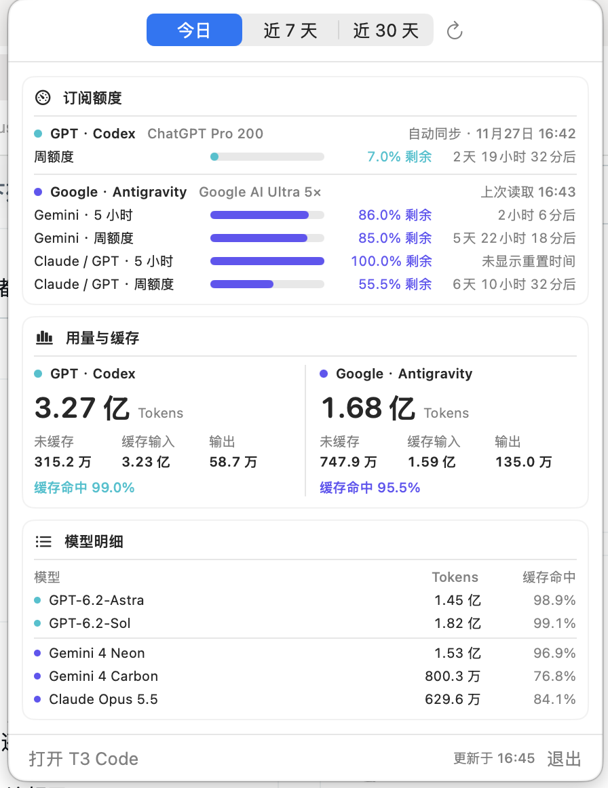

# T3 用量栏

给 Mac 上的 T3 Code 加一块中文菜单栏面板。点一下柱状图图标，就能看订阅额度、重置倒计时、Token 用量和缓存命中率。

## 最简单的安装方式

1. 打开 [发布页](https://github.com/tomjerryoutside-dotcom/t3-usage-bar/releases/latest)，下载 **`T3-Usage-Bar-v1.7-macOS-universal.zip`**。
2. 解压，将 **`T3 Usage Bar.app`** 拖到「应用程序」，双击打开。
3. 点菜单栏里的柱状图图标。首次使用前，在这台 Mac 上运行一次 T3 Code，完成相应提供方登录。

预编译版无需 Xcode、Python 或浏览器扩展。发布页可直接访问和下载，无需登录 GitHub。

下载的 App 使用临时签名，未经过 Apple 公证。macOS 可能在首次打开时拦截。请先确认包来自本仓库的发布页，可用随附的 SHA-256 文件校验。系统的首次打开流程见 [Apple 官方说明](https://support.apple.com/zh-cn/102445)。

```bash
shasum -a 256 -c T3-Usage-Bar-v1.7-macOS-universal.zip.sha256
```

要随登录启动，可在 macOS「系统设置 → 通用 → 登录项」加入 `T3 Usage Bar.app`。

## 界面截图



上图为实际运行截图，数字随账号、用量和同步时间变化。

## 适配范围

| 项目 | 当前适配 |
| --- | --- |
| Mac | 安装包包含 Apple 芯片（arm64）和 Intel（x86_64）两个版本，最低部署目标为 macOS 13 |
| 实机验证 | Apple 芯片 Mac、macOS 26.6.2、T3 Code 0.1.13。Intel 切片通过交叉编译、签名和 Rosetta 用量读取验证 |
| T3 数据 | 读取本机默认 `~/.t3` 数据目录。其他 T3 版本或自定义目录需要另行确认 |
| Codex | 已登录 ChatGPT 的 Codex 提供方。额度、重置时间和套餐名以 T3 的回报为准 |
| 反重力 | Token 用量来自 T3 本机记录。订阅额度需有可用的额度源。下文提供可选的本机助手 |
| Google One 档位 | 需要 Chrome 中已登录与反重力相同的 Google 账号，并安装可选扩展 |

## 面板里能看到什么

- **订阅额度**显示最近一次回报的剩余比例、进度条和精确到分钟的重置倒计时。额度源没有回报重置时间时，当行会明确提示。
- **用量与缓存**可按今日、近 7 天、近 30 天查看。汇总取自 T3 已完成回合的本机记录，按提供方列出输入、缓存输入、输出和缓存命中率。
- **模型明细**列出 GPT‑6.2 Astra、GPT‑6.2 Sol、Gemini 4 Neon、Gemini 4 Carbon 和 Claude Opus 5.5。提供方总用量也包含该提供方下其他已记录的模型。
- 面板运行时每分钟读一次额度和用量。T3 尚未更新 Codex 额度时，Codex 栏会显示上次收到额度的时间。

## 可选配置反重力额度

如果 T3 已配置 `http://127.0.0.1:<端口>/antigravity` 形式的本机 HTTP 额度源，面板会自动读取该地址，可以直接跳过此节。

需要从头配置时，先下载或克隆本仓库源码。助手适配本机 T3 的**默认 Antigravity 提供方实例**，使用 T3 托管的官方反重力 CLI 和个人 Google 账号登录。本机实测使用 **反重力 CLI 1.5.18**，自定义 CLI 路径和 API Key 模式需另行适配。

1. 在 T3「设置 → 提供方 → Antigravity」的环境变量里加入 `AGY_CLI_FORCE_FILE_TOKEN_STORAGE=true`。如果登录是在没有这个设置时完成的，使用同一个 Google 账号在 T3 内重新登录一次，让托管 CLI 生成对应的登录文件。
2. 终端进入本仓库目录，使用 Python 3.9 或更新版本安装本机助手。macOS 自带的 `/usr/bin/python3` 如提示缺少命令行工具，可先按 [Apple 官方说明](https://developer.apple.com/documentation/xcode/installing-the-command-line-tools/)安装。使用已安装的其他 Python 3.9 以上版本也可以。

   ```bash
   python3 scripts/setup-google.py
   ```

3. 在 T3「设置 → 提供方 → 用量提供方 → 添加 HTTP 来源」添加 `http://127.0.0.1:59417/antigravity`，启用该来源。菜单栏读取 T3 启用的本机地址。菜单栏和 T3 共用这份额度数据。[T3 额度来源说明](https://github.com/pingdotgg/t3code/blob/v0.1.13/docs/user/usage.md#connect-an-http-quota-source)

助手随当前 macOS 用户登录启动。它借助官方 CLI 的 `/usage` 读取订阅额度，要求查询回执为零模型回合、零 Token。短时查询失败时，额度栏可能显示上次读取时间。

### 可选配置 Google One 套餐档位

Google 额度源用于刷新剩余百分比和重置时间。要让 **Ultra 5× 或 20×** 这类套餐名也自动变更，在本仓库目录运行下面的命令。

```bash
python3 scripts/setup-google.py --chrome
```

在已登录对应 Google 账号的 Chrome 配置里打开 `chrome://extensions`，启用「开发者模式」，点「加载未打包的扩展程序」，选择终端打印的 **`Google One Sync`** 目录。打开成功后，扩展会启动一次核对，并在 Chrome 运行期间每 6 小时读取 Google One 当前方案。可点一下扩展图标手动触发核对。

这是一份本地扩展，须保持 Chrome 的开发者模式开启。读取进程只把套餐名和用于匹配账号的散列值送到本机助手。Chrome 进程退出后，面板显示该账号上次核对的套餐，下一次启动 Chrome 会再核对。

## 数据与配置放在哪里

- 主 App 通过只读连接查询本机 T3 数据。Codex 登录和套餐由 T3 管理。
- 可选助手监听 `127.0.0.1`，调用同一 Mac 上 T3 托管的反重力 CLI。Google One 扩展的本机同步密钥在安装时生成，账号核对记录保存在当前用户的 `~/Library/Application Support/T3 Usage Bar/Antigravity`。
- 需要卸载时，先在菜单中退出 App，再将 App 从「应用程序」移到废纸篓。装过可选组件时，可在 Chrome 扩展页停用扩展，并用下面的命令停用本机额度助手。

  ```bash
  launchctl bootout "gui/$(id -u)/local.t3-usage-bar.antigravity-quota"
  ```

## 从源码构建

安装 Apple 命令行工具或 Xcode，然后在仓库目录运行下面的命令。

```bash
./scripts/build.sh
```

`dist` 中会生成 `.app`、通用 ZIP 和 SHA-256 校验文件。

## 许可证

源码和发布包采用 [MIT 许可证](LICENSE)。可以使用、修改和再分发，保留版权声明与许可文本即可。
